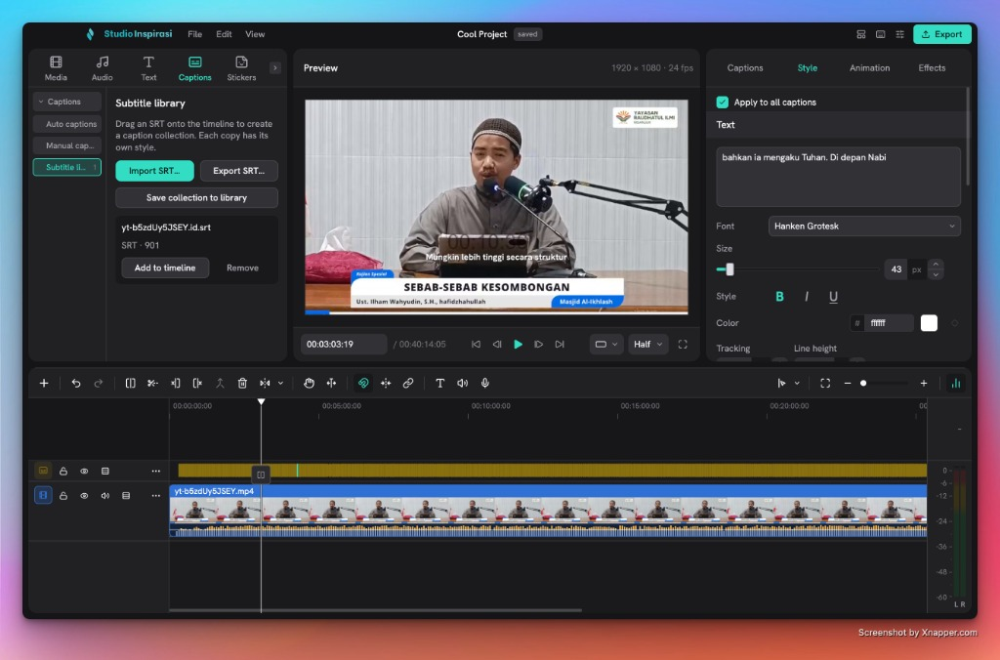

  

<strong>A desktop video editor built around an organised timeline and integrated creative libraries — kept alive on macOS Monterey 12.x (Intel).</strong>

  <a href="https://hams-rmdhn.github.io/studio-inspirasi/">Website</a> ·
  <a href="https://github.com/hams-rmdhn/studio-inspirasi/releases">Download</a> ·
  <a href="docs/README.md">Documentation</a> ·
  <a href="docs/BUILDING-macOS12.md">Build on Monterey</a> ·
  <a href="https://github.com/hams-rmdhn/studio-inspirasi/issues">Report an issue</a>

Studio Inspirasi is a free, open-source video editor for **macOS**, forked
from [Clovercut](https://github.com/tulcoturo/clovercut), which builds on
[Concat](https://github.com/jub0t/Concat). This fork exists for one reason:
the official macOS package no longer runs on macOS Monterey 12.x, and this
one does — with the complete AI feature set (cutout, smart brushes, enhance,
Whisper captions, Chatterbox TTS) enabled.

Editing and AI processing run locally, with no account, subscription or
export watermark.

## What Studio Inspirasi adds

Everything Clovercut offers, plus:

- **Full macOS Monterey 12.x support (x86_64).** A compatibility shim
  (`scripts/macos/libc++_monterey_shim.cpp`) supplies the libc++, Accelerate
  and VideoToolbox symbols newer macOS builds assume, so the bundled
  FFmpeg, ONNX Runtime and libplacebo libraries load on macOS 12.
- **All ONNX-based AI features on Monterey** — upstream disables them below
  macOS 13.4; this build re-enables them through the shim, with CPU
  fallback when the older CoreML refuses a model.
- **Optimised for Intel Macs with AVX2.** Whisper/GGML is compiled with
  `AVX2`, `FMA`, `F16C` and `BMI2` — several times faster transcription on
  Broadwell-and-newer Intel CPUs than the compatibility build upstream
  ships.
- **A maintained upgrade path.** `scripts/macos/sync-upstream.sh` merges
  new Clovercut releases while preserving this branding and the Monterey
  compatibility layer; see [docs/BUILDING-macOS12.md](docs/BUILDING-macOS12.md).

From Clovercut it inherits:

- **An organised timeline.** A fixed main video track anchors the edit, with
  overlays, titles, captions and stickers above it and audio below. Track types
  have distinct colours; adjustment layers stay within the visual zone. Cuts
  follow the selection or active track, and optional linkage respects track locks.
- **Workspace and shortcut presets.** Layouts for vertical video, audio editing,
  media browsing and detailed inspection. Shortcut profiles for CapCut,
  Premiere Pro, Final Cut Pro and DaVinci Resolve, with custom bindings.
- **Integrated content sources.** Browse OpenGameArt, Freesound and the YouTube
  Audio Library for music and sound effects, and GIPHY for animated stickers.
  Preview assets and add them to the timeline from the editor.
- **Personal creative libraries.** Keep favourites, recently used and most-used
  effects, filters, transitions and stickers across projects.
- **An expanded transition library.** Browse 123 supported GL Transitions,
  download them on demand and preview them by hovering over their cards.
  Installed transitions remain available offline.

## Download and install

[**Download Studio Inspirasi 0.1.9 for macOS Monterey+ (Intel)**](https://github.com/hams-rmdhn/studio-inspirasi/releases)

| Platform | Packages | Architectures |
|---|---|---|
| macOS 12 Monterey+ | DMG | Intel x86_64 |

The DMG is ad-hoc signed: on first launch, right-click the app and choose
**Open**, or approve it in System Settings → Privacy & Security.

## Local processing, optional online libraries

Editing, rendering and AI inference run on your computer. AI models require an
initial download and can then be used offline. Online content libraries are
optional and disabled by default.

Freesound requires an API key. The YouTube Audio Library uses a bundled local
connector and a dedicated browser sign-in. Online assets retain their providers'
licences and attribution requirements. See [content library setup](docs/AUDIO_LIBRARY.md).

## Documentation and development

- [Build on macOS Monterey 12.x and follow upstream](docs/BUILDING-macOS12.md)
- [Editing guide](docs/EDITING.md) and [keyboard shortcuts](docs/KEYBOARD_SHORTCUTS.md)
- [Content libraries](docs/AUDIO_LIBRARY.md), [personal lists](docs/LIBRARY_ORGANIZATION.md) and [GL Transitions](docs/GL_TRANSITIONS.md)
- [Build from source](docs/RELEASING.md#local-development) and [native dependencies](src/README.md#build-and-run)
- [Contributing](CONTRIBUTING.md) and [translations](TRANSLATING.md)

## Licence and attribution

Studio Inspirasi is an independent fork of Clovercut by tulcoturo, which is
itself based on Concat by Jareer and the Concat contributors, whose engine
and contributions remain credited. Distributed under
[AGPL-3.0-or-later](LICENSE). See [third-party notices](THIRD_PARTY_NOTICES.md)
and [trademark information](TRADEMARK.md).
